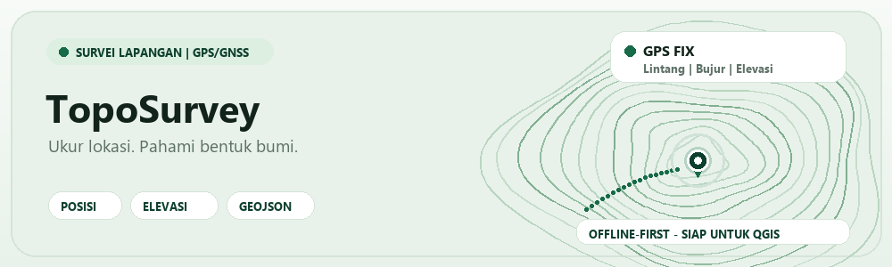

# 🗺️ TopoSurvey

[](https://github.com/SIG-3B/Toposurvey/actions/workflows/ci.yml)
[](https://github.com/SIG-3B/Toposurvey/actions/workflows/codeql.yml)
[](https://github.com/SIG-3B/Toposurvey/actions/workflows/pages.yml)

<p align="center">
  
</p>

> **Aplikasi survei topografi berbasis Android** untuk mengambil koordinat dan
> elevasi, melihat titik ukur di peta, dan mengelola hasil survei—tetap bisa
> digunakan **secara offline**.

| 📡 GPS/GNSS | 🗺️ Peta | 💾 Offline-first | 📤 Ekspor |
|---|---|---|---|
| Lintang, bujur, elevasi, dan akurasi posisi | OpenStreetMap dengan titik lokasi dan hasil survei | Data tersimpan lokal di SQLite | GeoJSON untuk pengolahan lanjutan |

### ✨ Yang bisa dilakukan

- Mengukur lokasi menggunakan GPS ponsel dan menampilkan lintang, bujur, serta
  elevasi.
- Melihat posisi dan titik survei pada peta OpenStreetMap.
- Menyimpan, melihat kembali, dan menghapus data tanpa server.
- Mengekspor data survei ke GeoJSON untuk digunakan di QGIS.

## 👥 Pembagian Tugas Kelompok

### 1. Survei Lapangan & Vlog

Melakukan survei GPS/GNSS, menerapkan metode trilaterasi, mengambil koordinat
dan elevasi, melengkapi data GeoJSON, serta mendokumentasikan kegiatan melalui
vlog.

- **Jumlah:** 7 orang *(6 nama dicantumkan; 1 nama belum dicantumkan).*
- **Anggota:** Zara · Bila · Rea · Rahma · Izal · Samuel

### 2. Developer Aplikasi Android

Membangun aplikasi survei topografi dengan fitur GPS, pengambilan koordinat
longitude/latitude dan elevasi, serta penyimpanan data.

- **Jumlah:** 4 orang
- **Anggota:** Azi · Fiqry · Maulana · Wahyu

### 3. Pengolahan Data & Peta Kontur

Mengolah dan menggabungkan data GeoJSON, melakukan interpolasi elevasi, serta
membuat peta kontur menggunakan QGIS.

- **Jumlah:** 4 orang
- **Anggota:** Haikal · Farhan · Ave · Dika

### 4. GitHub Workflow

Mengelola repository, CI/CD, analisis dan pengujian otomatis, Semantic
Versioning, auto-tag, build APK, checksum, serta publikasi GitHub Release.

- **Jumlah:** 4 orang
- **Anggota:** Ugi · Yonal · Rendra · Josua

## 📥 Unduh APK

- **Rilis terbaru:** [Buka GitHub Releases](https://github.com/SIG-3B/Toposurvey/releases/latest)
- **Semua versi:** [Riwayat rilis](https://github.com/SIG-3B/Toposurvey/releases)

Setiap rilis menyediakan satu APK. Rilis lama menggunakan nama APK berversi;
rilis baru dari workflow CI/CD menyediakan `TopoSurvey.apk` dan checksum
`TopoSurvey.apk.sha256`.

## 🌐 Website & CI/CD

- **Landing page:** [TopoSurvey di GitHub Pages](https://sig-3b.github.io/Toposurvey/)
- `docs/index.html` di-deploy melalui `.github/workflows/pages.yml` saat
  dokumentasi situs berubah di branch `main`.
- **Flutter CI** menjalankan analisis dan tes pada pull request. **Android
  Release** menjalankan tes sebelum membuat tag SemVer, menandatangani APK,
  membuat checksum SHA-256, dan menerbitkan release notes.
- Build APK otomatis berjalan untuk perubahan kode, aset, dependensi, dan
  sumber Android aplikasi—bukan perubahan dokumentasi atau konfigurasi build.
  Rilis manual tersedia di **Actions → Android Release → Run workflow** pada
  branch `main`.
- Dependabot memeriksa pembaruan dependensi; CodeQL memindai kode dan workflow.
- Panduan signing, secrets, release, dan perlindungan branch tersedia di
  [dokumentasi CI/CD](docs/CI-CD.md).

## 🧰 Teknologi

| Bagian | Teknologi |
|---|---|
| Aplikasi | Flutter, Dart, Material 3, Geolocator |
| Peta | Flutter Map, LatLong2, OpenStreetMap |
| Penyimpanan aplikasi | SQLite lokal (`sqlite3`, `path_provider`) |
| Backend opsional | FastAPI dan SQLite untuk pengujian REST API lokal |
| Peta kontur | QGIS dan data GeoJSON |

---

## 🚀 Menjalankan Proyek

### Prasyarat

Siapkan Flutter 3.47.5 (Dart 3.13.3), Android SDK dan emulator atau perangkat
Android, serta Python 3.11 atau lebih baru (opsional untuk menjalankan `backend/`).
Periksa instalasi Android dengan `flutter doctor -v`.

### 🧪 Backend (Opsional — REST API Lokal)

Dari root proyek di PowerShell:

```powershell
cd backend
python -m venv .venv
.\.venv\Scripts\python.exe -m pip install -r requirements.txt
.\.venv\Scripts\python.exe -m uvicorn main:app --host 127.0.0.1 --port 8000 --reload
```

Buka terminal lain untuk memeriksa endpoint:

```powershell
Invoke-RestMethod http://127.0.0.1:8000/api/health
```

Jika API dan tabel survei dapat diakses, responsnya HTTP 200 dengan
`{"status":"ok","database":"ok"}`. Backend membuat tabel `surveys` di
`backend/toposurvey.sqlite3` saat startup. Menjalankan ulang server tetap
menggunakan file database yang sama.

| Endpoint | Respons berhasil |
|---|---|
| `GET /api/health` | `200` dengan status API dan SQLite |
| `POST /api/surveys` | `201` dengan survei yang tersimpan |
| `GET /api/surveys` | `200` dengan daftar survei, ID terbaru di atas |
| `GET /api/surveys/{id}` | `200` dengan detail survei |
| `DELETE /api/surveys/{id}` | `204` tanpa isi |

Contoh menyimpan survei dan membaca kembali hasilnya:

```powershell
$survey = Invoke-RestMethod -Method Post http://127.0.0.1:8000/api/surveys -ContentType 'application/json' -Body '{"latitude":-6.9,"longitude":107.6,"elevation":-4.5}'
Invoke-RestMethod "http://127.0.0.1:8000/api/surveys/$($survey.id)"
```

Kirim `latitude` dari −90 hingga 90, `longitude` dari −180 hingga 180,
serta `elevation` dalam meter sebagai angka JSON. Elevasi negatif diterima.
Backend pengembangan tidak memakai autentikasi dan sebaiknya hanya diakses
melalui `127.0.0.1`; jangan bind ke `0.0.0.0` atau mengeksposnya ke jaringan
publik tanpa menambahkan autentikasi dan kontrol akses. Jika elevasi tidak
tersedia, permintaan ditolak dengan `422`. Server menetapkan
`created_at` dalam format ISO 8601 UTC saat menyimpan survei. ID yang tidak
ditemukan menghasilkan `404`. Gangguan SQLite saat server berjalan
menghasilkan `503`. Dokumentasi interaktif tersedia di `/docs`.

### 📱 Aplikasi Flutter

Nyalakan emulator atau hubungkan perangkat Android, lalu jalankan dari root proyek:

```powershell
cd frontend
flutter pub get
flutter analyze
flutter test
flutter run
```

## 🧭 Fitur Aplikasi

Secara default aplikasi berjalan menggunakan `TopoSurveyApp.local()`, sehingga
seluruh penyimpanan dan pembacaan riwayat survei dilakukan **secara offline
menggunakan database SQLite lokal di perangkat** (`toposurvey.sqlite3` pada
direktori dokumen aplikasi) tanpa memerlukan server eksternal.

### 🛰️ GPS dan Elevasi

Buka tab **Survei**, ketuk **Aktifkan GPS** jika muncul, lalu beri izin lokasi
untuk melihat garis
lintang, garis bujur, ketinggian dalam meter, dan perkiraan akurasi horizontal.
Aplikasi meminta pembaruan posisi dengan akurasi tinggi hanya saat tab Survei
terbuka dan aplikasi berada di depan. Ketinggian Android mengacu pada
[elipsoid WGS 84](https://developer.android.com/reference/android/location/Location#getAltitude()).
Jika ponsel tidak memberikan elevasi, layar menampilkan tanda strip.
Akurasi horizontal yang ditampilkan adalah perkiraan radius posisi. Nilai itu
tidak mengukur ketelitian elevasi. Akurasi GNSS ponsel dipengaruhi kondisi
sinyal, misalnya gedung atau pepohonan yang menghalangi pandangan ke langit.
Gunakan perangkat survei geodetik jika pekerjaan mensyaratkan ketelitian
geodetik. [Referensi akurasi GPS](https://www.gps.gov/gps-accuracy)

### 🗺️ Peta

Peta dapat digeser dan diperbesar. Marker biru mengikuti posisi ponsel, dan
lingkaran menunjukkan perkiraan akurasi horizontal jika tersedia. Peta memusat
saat posisi pertama diterima. Gunakan tombol **Kembali ke posisi saya**
untuk memusatkan lagi. Gambar peta memerlukan internet. Pengukuran GPS tetap
berjalan apabila tile gagal dimuat, dengan tombol untuk mencoba memuat peta lagi.
Atribusi peta menautkan [OpenStreetMap](https://www.openstreetmap.org/copyright).

### 💾 Penyimpanan dan Ekspor

Setelah koordinat dan elevasi valid, pilih **Simpan Hasil Survei**. Aplikasi
menyimpan pembacaan langsung ke SQLite lokal perangkat. Beranda, Riwayat, dan
marker hijau di peta langsung memuat ulang data dari SQLite lokal. Riwayat
memakai `created_at` dalam UTC sebagai waktu simpan dan menampilkannya dalam zona
waktu perangkat. Gunakan Riwayat untuk melihat detail, menghapus survei, atau
mengekspor data ke format **GeoJSON (`FeatureCollection`)** lewat tombol
**Ekspor GeoJSON** (bisa langsung **Unduh (.geojson)** ke folder `Download/`,
**Salin** ke *clipboard*, atau **Bagikan** ke aplikasi lain).

Untuk menguji GPS lapangan, gunakan ponsel Android dengan layanan lokasi
aktif. Lokasi dari emulator adalah simulasi.
